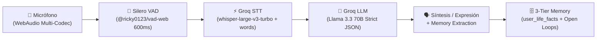

# 🎙️ Pattern: Low-Latency Voice & 3-Tier Episodic Memory Pipeline

> **Contexto:** Arquitectura de extremo a extremo para interacción por voz de ultra-baja latencia (< 800 ms percibidos) combinada con extracción de métricas acústico-lingüísticas y memoria episódica en 3 capas sin bases vectoriales costosas.

Relacionado con: [Catálogo de Patrones](../README.md) | `ADR-001` (proyecto PeraTomo en Obsidian) | `ADR-003` (proyecto PeraTomo en Obsidian) | `ADR-005` (proyecto PeraTomo en Obsidian)

---

## 1. Visión General del Pipeline



---

## 2. Captura WebAudio Multi-Codec (Chromium vs Apple WebKit)

Los contenedores de `MediaRecorder` difieren entre motores de renderizado:
- **Chromium (Windows, Android, Chrome/Edge):** Soporta nativamente `audio/webm;codecs=opus` (alta compresión y excelente calidad para voz a 16 kHz).
- **Apple WebKit (macOS WKWebView, iOS Safari/WKWebView):** No soporta `audio/webm;codecs=opus` en todas las versiones o falla silenciosamente; requiere fallback prioritario a `audio/mp4` (AAC).

### Helper de Detección de MIME Type y Extensión

```typescript
export interface AudioMimeConfig {
  mimeType: string;
  extension: 'webm' | 'm4a' | 'mp4' | 'wav';
}

export function resolveSupportedAudioMime(): AudioMimeConfig {
  const candidates: AudioMimeConfig[] = [
    { mimeType: 'audio/webm;codecs=opus', extension: 'webm' },
    { mimeType: 'audio/webm', extension: 'webm' },
    { mimeType: 'audio/mp4;codecs=mp4a.40.2', extension: 'm4a' },
    { mimeType: 'audio/mp4', extension: 'mp4' },
  ];

  if (typeof MediaRecorder !== 'undefined') {
    for (const candidate of candidates) {
      if (MediaRecorder.isTypeSupported(candidate.mimeType)) {
        return candidate;
      }
    }
  }
  return { mimeType: 'audio/mp4', extension: 'm4a' };
}
```

### Desbloqueo de `AudioContext` en iOS / Apple WebKit

En iOS y WKWebView, todo `AudioContext` nace en estado `'suspended'` hasta que ocurre un gesto explícito del usuario (`pointerdown` / `touchend`) y se reproduce un buffer silencioso de 1 sample.

```typescript
let sharedAudioContext: AudioContext | null = null;

export async function unlockAudioContextOnGesture(): Promise<AudioContext> {
  const AudioCtx = window.AudioContext || (window as unknown as { webkitAudioContext: typeof AudioContext }).webkitAudioContext;
  if (!sharedAudioContext) {
    sharedAudioContext = new AudioCtx({ sampleRate: 16000 });
  }

  if (sharedAudioContext.state === 'suspended') {
    await sharedAudioContext.resume();
  }

  // Reproducir buffer de 1 sample silencioso para desbloquear el canal de hardware en iOS
  const buffer = sharedAudioContext.createBuffer(1, 1, 22050);
  const source = sharedAudioContext.createBufferSource();
  source.buffer = buffer;
  source.connect(sharedAudioContext.destination);
  source.start(0);

  return sharedAudioContext;
}
```

---

## 3. Detección de Actividad de Voz (Silero VAD a 600ms)

Usamos `@ricky0123/vad-web` ejecutando el modelo **Silero VAD en ONNX WebAssembly** directamente en el cliente. Esto evita transmitir silencio por la red (ahorrando costos de API y batería).

### Parámetros Óptimos para Compañero Bilingüe
- `redemptionFrames` / corte por silencio: **600ms** (`redemptionFrames: 6` a ~96ms por frame o `redemptionTimeMs: 600`). Un corte menor (300ms) interrumpe al estudiante que piensa una palabra en inglés; un corte mayor (1200ms) se siente lento.
- `positiveSpeechThreshold`: `0.65` (evita disparos por ruido de teclado).
- `negativeSpeechThreshold`: `0.40`.
- `minSpeechFrames`: `3` (descarta clics o suspiros cortos).

```typescript
import { MicVAD } from '@ricky0123/vad-web';

export async function createVoiceDetector(onSpeechSegment: (wavFloat32: Float32Array) => void) {
  return await MicVAD.new({
    positiveSpeechThreshold: 0.65,
    negativeSpeechThreshold: 0.40,
    redemptionFrames: 6, // ~600ms de pausa para confirmar fin de turno
    preSpeechPadFrames: 3,
    minSpeechFrames: 3,
    onSpeechEnd: (audio: Float32Array) => {
      onSpeechSegment(audio);
    },
  });
}
```

---

## 4. Transcripción + Timestamps con Groq `whisper-large-v3-turbo`

Al enviar el segmento de audio a Groq Audio Transcriptions API:
- **Modelo:** `whisper-large-v3-turbo` (latencia ~150-250ms).
- **Formato:** `response_format: "verbose_json"` con `timestamp_granularities: ["word", "segment"]`.
- **No forzar `language: "en"`:** Se deja en autodetección o prompt bilingüe (`"Spanglish conversation, English and Spanish"`) para permitir *code-switching* natural sin alucinaciones.

### Cálculo de WPM y Ratio de Inglés en Tiempo Real

Con el arreglo `words` (`[{ word, start, end }]`):
1. **Duración neta de habla (`speechDurationSec`):** Suma de `(word.end - word.start)` o `(lastWord.end - firstWord.start)` descontando pausas largas (> 1.0s).
2. **Palabras por minuto (`WPM`):** `(totalWords / speechDurationSec) * 60`.
3. **Detección de Ratio en Inglés (`englishRatio`):** Clasificación léxica + evaluación del LLM en el turno para determinar qué porcentaje de la frase fue producida en inglés (`0.0` a `1.0`).

---

## 5. Inferencia Estructurada con Llama JSON Estricto

El texto transcrito + las métricas acústicas (`wpm`, `pause_count`) + el contexto de memoria se envían a **Groq (`llama-3.3-70b-versatile`)** con `response_format: { type: "json_object" }`.

### Contrato JSON de Salida del LLM

```json
{
  "reply_text": "No way! You finally beat that boss? Next time try saying: 'I beat it on my third try!'",
  "emotion": "excited",
  "language_analysis": {
    "english_ratio": 0.75,
    "detected_cefr_turn": "B1",
    "gse_estimate_turn": 48,
    "natural_recast": "I beat it on my third try!"
  },
  "economy_delta": {
    "spoken_english_valid": true,
    "energy_delta": 12,
    "pera_coins_delta": 6
  },
  "memory_updates": [
    {
      "category": "hobbies",
      "fact_key": "current_videogame",
      "fact_value": "Playing Elden Ring, just defeated Margit",
      "is_open_loop": true,
      "follow_up_after_hours": 24
    }
  ]
}
```

---

## 6. Arquitectura de Memoria Episódica en 3 Capas

Para evitar la complejidad y el costo de bases vectoriales (pgvector/Pinecone) en los primeros 10,000 usuarios, implementamos una **Memoria Jerárquica en 3 Capas** ultrarrápida (< 5 ms por consulta):

| Capa | Nombre | Almacenamiento | Contenido y Ciclo de Vida |
| :--- | :--- | :--- | :--- |
| **Tier 1** | **Working Memory (RAM)** | Estado reactivo en cliente (Svelte 5 Runes) | Últimos 8–10 turnos literales de la sesión activa + estado emocional actual. |
| **Tier 2** | **Episodic & Open Loops (`user_life_facts`)** | Tabla PostgreSQL indexada por `(user_id, status, is_open_loop)` | Hechos clave de la vida del usuario (`fact_key`, `fact_value`) y **Open Loops** (eventos pendientes con `follow_up_after` para preguntar al día siguiente). |
| **Tier 3** | **Consolidated Buckets (`session_buckets`)** | Tabla PostgreSQL JSONB por fecha | Resumen diario de sesiones, evolución de `gse_score`, `cefr_level` y `avg_wpm`. |

### ¿Qué es un Open Loop Cotidiano?
Cuando el usuario menciona un evento futuro o en curso (*"Mañana tengo una entrevista técnica"* o *"Hoy a la noche juego un partido"*), el LLM marca `is_open_loop: true` y define `follow_up_after_hours: 18`. En la siguiente sesión posterior a esa fecha, el sistema inyecta ese Open Loop en el System Prompt para que el compañero pregunte proactivamente: *"Hey! How did that technical interview go?"*
