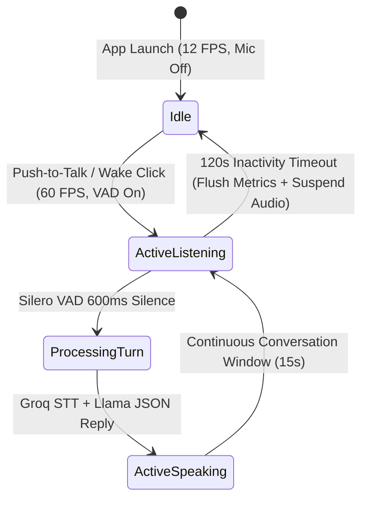

# 🦀 Pattern: Tauri v2 Cross-Platform, Zero-Idle & Plugin Mode Registry

> **Contexto:** Arquitectura cliente multiplataforma (Windows, macOS, Android, iOS) usando **SvelteKit (SPA) + Tauri v2**, optimizada para consumo casi nulo en reposo (*Zero-Idle Connections* estilo WhatsApp) y extensibilidad modular mediante **Plugin Mode Registry**.

Relacionado con: [Catálogo de Patrones](../README.md) | `ADR-001` (proyecto PeraTomo en Obsidian) | `ADR-005` (proyecto PeraTomo en Obsidian)

---

## 1. SvelteKit con `@sveltejs/adapter-static` y `ssr = false`

Tauri v2 sirve los assets del frontend directamente desde el binario nativo hacia el WebView del sistema operativo (WebView2 en Windows, WKWebView en macOS/iOS, Android WebView en Android). No existe un servidor Node.js en tiempo de ejecución dentro del cliente.

### Configuración de `svelte.config.js`

```javascript
import adapter from '@sveltejs/adapter-static';
import { vitePreprocess } from '@sveltejs/vite-plugin-svelte';

/** @type {import('@sveltejs/kit').Config} */
const config = {
  preprocess: vitePreprocess(),
  kit: {
    adapter: adapter({
      pages: 'build',
      assets: 'build',
      fallback: 'index.html',
      precompress: false,
      strict: true
    })
  }
};

export default config;
```

### Configuración Obligatoria en `src/routes/+layout.ts`

```typescript
// Desactiva SSR globalmente para permitir acceso directo a WebAudio, WebGL/Canvas y APIs de Tauri v2
export const ssr = false;
export const prerender = true;
```

---

## 2. Tauri v2 para Windows, macOS, Android e iOS

Un único código base en Rust (`src-tauri`) y Svelte 5 compila a las 4 plataformas ajustando el comportamiento de ventana según capacidades del sistema operativo.

### Ventana Transparente `alwaysOnTop` (Desktop: Windows & macOS)

En escritorio, el compañero vive como un *widget* flotante sin bordes sobre el área de trabajo:

```json
// src-tauri/tauri.conf.json (fragmento de app.windows)
{
  "app": {
    "macOSPrivateApi": true,
    "windows": [
      {
        "label": "main",
        "title": "PeraTomo",
        "width": 380,
        "height": 480,
        "resizable": false,
        "decorations": false,
        "transparent": true,
        "alwaysOnTop": true,
        "shadow": false
      }
    ]
  }
}
```

> [!IMPORTANT]
> En **macOS**, habilitar `"macOSPrivateApi": true` en `tauri.conf.json` es indispensable para que `transparent: true` renderice el fondo alfa real en `WKWebView`. En **iOS y Android**, Tauri ignora `alwaysOnTop` y `decorations: false`, montando la vista a pantalla completa con respeto a los `safe-area-inset-*` de CSS.

### Permisos Nativos (iOS / macOS `Info.plist` & Android `AndroidManifest.xml`)
- **macOS / iOS (`Info.plist`):** `NSMicrophoneUsageDescription` obligatorio para que WebKit permita `navigator.mediaDevices.getUserMedia({ audio: true })`.
- **Android (`AndroidManifest.xml`):** `<uses-permission android:name="android.permission.RECORD_AUDIO" />` y `<uses-permission android:name="android.permission.INTERNET" />`.

---

## 3. Zero-Idle Connections (Estilo WhatsApp)

Un compañero de escritorio permanece abierto durante horas mientras el usuario programa, estudia o juega. Mantener conexiones WebSocket abiertas (Supabase Realtime) o el micrófono capturando continuamente cuando el compañero duerme agota la batería y consume cuotas de base de datos.

### Reglas del Patrón Zero-Idle
1. **Cero WebSockets en Reposo:** No se abren canales de Supabase Realtime salvo que exista una función multijugador activa. Toda sincronización usa peticiones HTTPS `POST` efímeras vía RPC (`flush_session_metrics`).
2. **Suspensión de VAD y AudioContext en Estado `IDLE / SLEEP`:** Si pasan `120 segundos` sin actividad de voz o el usuario pone a PeraTomo en modo descanso, se pausa el loop de Silero VAD y se suspende el `AudioContext` (`audioCtx.suspend()`).
3. **Throttling de FPS del Avatar:**
   - **Hablando / Escuchando (`ACTIVE`):** `60 FPS` (sincronización labial e interpolación fluida).
   - **En espera (`IDLE`):** `12 FPS` (animación de parpadeo y respiración ligera).
   - **Oculto / Minimizado (`HIDDEN`):** `0 FPS` (pausa total de `requestAnimationFrame`).



---

## 4. Arquitectura Plugin Mode Registry

Para evitar un componente monolítico lleno de condicionales (`if (mode === 'onboarding') ... else if (mode === 'shop')`), implementamos un **Plugin Mode Registry** desacoplado. Cada modo de interacción o minijuego futuro (ej. motor narrativo `inkjs`, tienda de accesorios, modo enfoque Pomodoro) se registra como un plugin con ciclo de vida propio.

### Contrato TypeScript del Plugin Mode Registry

```typescript
export type CompanionModeId = 'companion_free_chat' | 'onboarding_4turns' | 'accessory_shop' | 'ink_story_mode';

export interface ModeContext {
  userId: string;
  cefrLevel: string;
  gseScore: number;
  energy: number;
  peraCoins: number;
}

export interface CompanionModePlugin {
  id: CompanionModeId;
  title: string;
  requiresMic: boolean;
  onEnter(ctx: ModeContext): Promise<void>;
  onTurnInput?(transcript: string, metrics: { wpm: number; englishRatio: number }): Promise<void>;
  onExit(ctx: ModeContext): Promise<void>;
}

class ModeRegistry {
  private plugins = new Map<CompanionModeId, CompanionModePlugin>();
  private activePlugin: CompanionModePlugin | null = null;

  register(plugin: CompanionModePlugin): void {
    this.plugins.set(plugin.id, plugin);
  }

  async switchTo(id: CompanionModeId, ctx: ModeContext): Promise<CompanionModePlugin> {
    if (this.activePlugin) {
      await this.activePlugin.onExit(ctx);
    }
    const next = this.plugins.get(id);
    if (!next) throw new Error(`Plugin mode "${id}" is not registered.`);
    this.activePlugin = next;
    await next.onEnter(ctx);
    return next;
  }

  get current(): CompanionModePlugin | null {
    return this.activePlugin;
  }
}

export const companionModeRegistry = new ModeRegistry();
```

### Ventajas del Registro de Modos
- **Open/Closed Principle:** Agregar el futuro modo narrativo con `inkjs` (`ADR-002` (proyecto PeraTomo en Obsidian)) solo requiere registrar un nuevo `CompanionModePlugin` sin tocar el pipeline de voz ni el estado global.
- **Limpieza garantizada de recursos:** `onExit()` asegura que cualquier temporizador, stream de audio o estado temporal se limpie antes de cambiar de modo.
