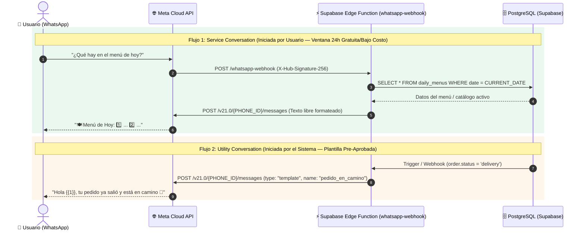

# 💬 Pattern: WhatsApp Cloud API Serverless Webhook & Cost-Optimized Notifications

> **Contexto:** Arquitectura serverless sobre **Supabase Edge Functions (Deno) + Meta WhatsApp Cloud API** para atención automatizada de consultas en tiempo real y notificaciones transaccionales de estado de pedidos/servicios, minimizando el costo por conversación de Meta.

Relacionado con: [Catálogo de Patrones](../README.md)

---

## 1. Visión General del Flujo



---

## 2. Verificación Criptográfica y Handshake del Webhook (`whatsapp-webhook`)

La Edge Function cumple un doble rol según el método HTTP recibido:
- **`GET` (Handshake de Meta):** Valida `hub.mode === 'subscribe'` y `hub.verify_token === Deno.env.get('META_VERIFY_TOKEN')`, devolviendo el `hub.challenge` en texto plano.
- **`POST` (Evento Entrante):** Verifica la firma HMAC-SHA256 en el header `x-hub-signature-256` usando el `META_APP_SECRET` antes de procesar cualquier mensaje o consultar la base de datos.

### Implementación Base en Supabase Edge Functions (Deno / TypeScript)

```typescript
import { serve } from 'https://deno.land/std@0.224.0/http/server.ts';
import { createClient } from 'https://esm.sh/@supabase/supabase-js@2';

const VERIFY_TOKEN = Deno.env.get('META_VERIFY_TOKEN')!;
const ACCESS_TOKEN = Deno.env.get('META_ACCESS_TOKEN')!;
const PHONE_NUMBER_ID = Deno.env.get('META_PHONE_NUMBER_ID')!;

serve(async (req: Request) => {
  const url = new URL(req.url);

  // 1. Handshake de verificación de Meta (GET)
  if (req.method === 'GET') {
    const mode = url.searchParams.get('hub.mode');
    const token = url.searchParams.get('hub.verify_token');
    const challenge = url.searchParams.get('hub.challenge');

    if (mode === 'subscribe' && token === VERIFY_TOKEN && challenge) {
      return new Response(challenge, { status: 200 });
    }
    return new Response('Forbidden', { status: 403 });
  }

  // 2. Recepción de mensajes entrantes (POST)
  if (req.method === 'POST') {
    const body = await req.json();
    const message = body?.entry?.[0]?.changes?.[0]?.value?.messages?.[0];

    if (message?.type === 'text') {
      const senderPhone = message.from;
      const incomingText = (message.text.body as string).toLowerCase().trim();

      const supabase = createClient(
        Deno.env.get('SUPABASE_URL')!,
        Deno.env.get('SUPABASE_SERVICE_ROLE_KEY')!
      );

      if (/(menu|menú|comer|catalogo|catálogo)/.test(incomingText)) {
        const today = new Date().toISOString().split('T')[0];
        const { data: menu } = await supabase
          .from('daily_menus')
          .select('*')
          .eq('date', today)
          .maybeSingle();

        const reply = menu
          ? `🍽️ *Menú del Día*\n\n1️⃣ ${menu.menu_1_name}\n2️⃣ ${menu.menu_2_name}\n3️⃣ ${menu.menu_3_name}\n🍰 ${menu.dessert_name ?? 'Sin postre'}`
          : 'Aún no hemos publicado el menú de hoy. ¡Consultanos nuevamente en unos minutos!';

        await sendFreeformText(senderPhone, reply);
      }
    }

    // Meta exige responder 200 OK rápidamente para evitar reintentos exponenciales
    return new Response('OK', { status: 200 });
  }

  return new Response('Method Not Allowed', { status: 405 });
});

async function sendFreeformText(to: string, body: string): Promise<void> {
  await fetch(`https://graph.facebook.com/v21.0/${PHONE_NUMBER_ID}/messages`, {
    method: 'POST',
    headers: {
      Authorization: `Bearer ${ACCESS_TOKEN}`,
      'Content-Type': 'application/json',
    },
    body: JSON.stringify({
      messaging_product: 'whatsapp',
      to,
      type: 'text',
      text: { body },
    }),
  });
}
```

---

## 3. Estrategia de Optimización de Costos (Service vs. Utility Windows)

Meta factura las conversaciones de WhatsApp Cloud API según quién inicia la interacción y qué categoría de plantilla se emplea:

| Tipo de Interacción | Quién Inicia | Formato Permitido | Regla de Costo y Diseño |
| :--- | :--- | :--- | :--- |
| **Service Conversation** | **Usuario** (escribe al bot) | Texto libre (`type: "text"`) o listas interactivas durante **24 horas** desde el último mensaje del cliente. | Costo nulo/mínimo. Ideal para responder menú del día, precios, horarios o estado de un pedido a demanda. |
| **Utility Conversation** | **Negocio** (fuera de ventana de 24h) | Obligatoriamente **Template Message** (`type: "template"`) pre-aprobado por Meta (ej. `pedido_en_camino`). | Tiene costo por mensaje entregado. Disparar **únicamente en transiciones críticas de estado** (ej. cuando el pedido pasa a `delivery`). |

### Envío de Notificación Saliente con Plantilla (`sendTemplateNotification`)

```typescript
export async function sendOrderDispatchedTemplate(
  recipientPhone: string,
  customerName: string
): Promise<void> {
  await fetch(`https://graph.facebook.com/v21.0/${PHONE_NUMBER_ID}/messages`, {
    method: 'POST',
    headers: {
      Authorization: `Bearer ${ACCESS_TOKEN}`,
      'Content-Type': 'application/json',
    },
    body: JSON.stringify({
      messaging_product: 'whatsapp',
      to: recipientPhone,
      type: 'template',
      template: {
        name: 'pedido_en_camino',
        language: { code: 'es_AR' },
        components: [
          {
            type: 'body',
            parameters: [{ type: 'text', text: customerName }],
          },
        ],
      },
    }),
  });
}
```
